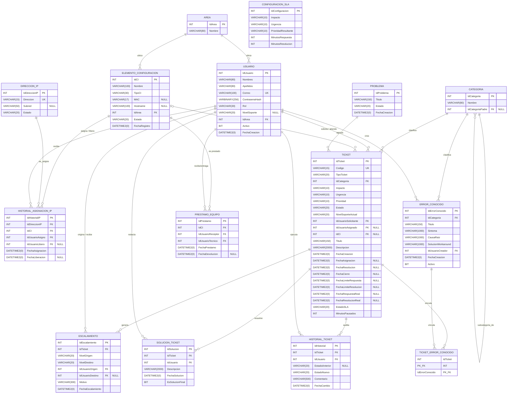
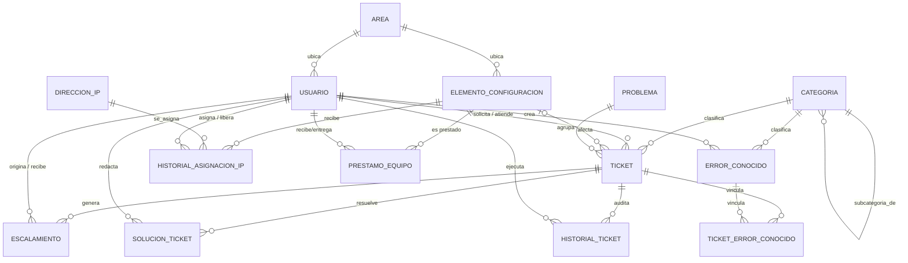

# Diseño de Base de Datos (SQL Server) — v2 Simplificada
## Service Desk ITIL v4 — Hospital Santa María del Socorro
 
**Principio arquitectónico:** La base de datos se usa exclusivamente para **almacenamiento**. Toda la lógica de negocio (matriz de prioridades, reglas de SLA, transiciones de estado) vive en el Backend (Java/Spring Boot) como `ENUM`s y servicios de dominio. Los catálogos antes modelados como tablas (`Rol`, `Impacto`, `Urgencia`, `Prioridad`, `EstadoTicket`, `EstadoSLA`, `NivelSoporte`, `TipoTicket`, `TipoCI`, `MatrizPrioridad`, `DefinicionSLA`, `EstadoIP`) desaparecen del modelo relacional y se guardan como texto (`VARCHAR`) validado por el `ENUM` de Java al momento de escribir.
 
---
 
## 1. Diagrama Entidad-Relación (Mermaid)
 

 
### 1.1 Diagrama Lógico (Sin Atributos)
 

 
---
 
## 2. Criterio de eficiencia de tipos de datos
 
Con la lógica fuera de la base de datos, el criterio de eficiencia cambia de enfoque: ya no se optimiza para minimizar tablas de catálogo (`TINYINT` referenciando filas), sino para minimizar el tamaño de cada valor `VARCHAR` que representa un `ENUM` del backend, y para blindar la integridad del dato aun sin tablas de referencia.
 
| Regla | Justificación |
|---|---|
| `VARCHAR(N)` con `N` ajustado al valor de texto más largo del `ENUM` correspondiente (nunca `VARCHAR(MAX)` ni tamaños genéricos de 50+) | El `ENUM` de Java define un conjunto cerrado y conocido de valores (ej. `Prioridad.CRITICA` → 7 caracteres); dimensionar el campo al máximo real evita desperdicio de páginas de datos sin sacrificar flexibilidad. |
| `CHECK CONSTRAINT` en cada columna `VARCHAR` que representa un `ENUM` | Aunque la validación principal ocurre en el Backend, un `CHECK` (ej. `CHECK (Estado IN ('NUEVO','ASIGNADO','EN_PROCESO','ESCALADO','RESUELTO','CERRADO','REABIERTO'))`) actúa como última barrera de integridad ante escritura directa a la BD (migraciones, scripts, otro sistema), sin convertir a la BD en "dueña" de la regla — solo la protege. |
| Valores de `ENUM` en `UPPER_SNAKE_CASE` sin acentos (ej. `EN_PROCESO`, no `"En Proceso"`) | Coincide 1:1 con la convención de nombres de `ENUM` en Java, evita comparaciones sensibles a mayúsculas/tildes entre capas, y permite usar la collation por defecto sin ambigüedad. |
| `VARCHAR` (no `NVARCHAR`) se mantiene igual que en la v1 | El sistema sigue siendo monolingüe en español; no cambia esta decisión al remover los catálogos. |
| `INT IDENTITY` como PK en todas las 12 tablas (se elimina el uso de `TINYINT`/`SMALLINT` como PK) | Al desaparecer los catálogos pequeños, ya no existen PKs de bajísimo volumen; se estandariza `INT` para simplificar el modelo, priorizando consistencia y velocidad de desarrollo por sobre el ahorro de 3 bytes que aportaba `TINYINT` en tablas que ya no existen. |
| `DATETIME2(0)`, `BIT` y `VARBINARY(256)` se mantienen sin cambios | Estas decisiones no dependían de la ubicación de la lógica de negocio, siguen siendo válidas. |
 
**Trade-off explícito (para sustentar ante el jurado):** se renuncia deliberadamente a la integridad referencial estricta que daban los catálogos (`FOREIGN KEY` imposibilitaba un valor inválido a nivel de motor de BD) a cambio de mayor velocidad de desarrollo y menos joins. El `CHECK CONSTRAINT` es la mitigación elegida para no dejar la columna completamente desprotegida.
 
---
 
## 3. Matriz de Roles y Permisos (RBAC)

De acuerdo con las decisiones de diseño, el acceso al sistema se rige mediante un control de acceso basado en roles (RBAC). Estos valores se almacenan en el campo `Rol` de la tabla `USUARIO`:

| Rol | Nivel | Responsabilidades y Permisos (Alcance) |
|---|---|---|
| **USUARIO_FINAL** | Básico | **(Ej. Médicos, Enfermeras, Administrativos)** - **Permisos:** Crear tickets de incidentes/peticiones, interactuar y hacer seguimiento solo de sus propios tickets, y acceder al módulo público (autoayuda) de la Base de Conocimiento (KEDB). - **Restricciones:** No pueden ver tickets de terceros, editar configuraciones ni inventarios. |
| **SERVICE_DESK_N1** | Soporte N1 | **(Ej. Practicantes, Técnicos de Soporte 1ra línea)** - **Permisos:** Atender, asignar y resolver tickets que lleguen a la bandeja. Escalar tickets a N2. Enlazar activos dinámicamente en la CMDB y registrar préstamos temporales. Tienen permiso para publicar artículos de conocimiento **directamente** (sin aprobación previa) en la KEDB. - **Restricciones:** No pueden alterar reglas de SLA ni ver reportes gerenciales (Dashboard). |
| **SOPORTE_N2_ESPECIALISTA** | Soporte N2 | **(Ej. Ingenieros o Especialistas de red/servidores)** - **Permisos:** Recibir y resolver tickets complejos escalados. Analizar y gestionar Problemas (incidentes agrupados). Modificar configuraciones avanzadas en la CMDB. |
| **ADMINISTRADOR** | Gestión | **(Ej. Jefe de TI o Administrador del Sistema)** - **Permisos:** Acceso y control total. Únicos autorizados a usar el Panel de Configuración de SLA (modificar tiempos, urgencia/impacto). Acceso al Dashboard de indicadores, KPIs y exportación a PDF. Administración completa de usuarios y áreas. |

---
 
## 4. Diccionario de Datos Optimizado (15 tablas núcleo)
 
### 3.1 USUARIO
| Campo | Tipo | Notas |
|---|---|---|
| IdUsuario | INT PK IDENTITY | |
| Nombres | VARCHAR(80) | |
| Apellidos | VARCHAR(80) | |
| Correo | VARCHAR(100) UNIQUE | |
| ContrasenaHash | VARBINARY(256) | Hash (bcrypt/SHA-256), nunca texto plano |
| Rol | VARCHAR(30) CHECK | `ENUM Rol`: `USUARIO_FINAL`, `SERVICE_DESK_N1`, `SOPORTE_N2_ESPECIALISTA`, `ADMINISTRADOR` |
| NivelSoporte | VARCHAR(20) NULL CHECK | `ENUM NivelSoporte`: `N1`, `N2`, `ESPECIALISTA`; NULL si el rol no es de soporte |
| IdArea | INT FK → Area | |
| Activo | BIT DEFAULT 1 | |
| FechaCreacion | DATETIME2(0) | |
 
### 3.2 AREA
| Campo | Tipo |
|---|---|
| IdArea | INT PK IDENTITY |
| Nombre | VARCHAR(80) — Emergencia, UCI, Farmacia, Admisión, etc. |
 
### 3.3 CATEGORIA
| Campo | Tipo |
|---|---|
| IdCategoria | INT PK IDENTITY |
| Nombre | VARCHAR(80) |
| IdCategoriaPadre | INT NULL FK → Categoria (autorreferencia, jerarquía) |
 
### 3.4 ELEMENTO_CONFIGURACION (CMDB + Activos de red)
| Campo | Tipo | Notas |
|---|---|---|
| IdCI | INT PK IDENTITY | |
| Nombre | VARCHAR(100) | |
| TipoCI | VARCHAR(30) CHECK | `ENUM TipoCI`: `PC`, `IMPRESORA`, `SERVIDOR`, `SOFTWARE`, `RED` |
| MAC | VARCHAR(17) NULL | Formato `AA:BB:CC:DD:EE:FF`, solo aplica a equipos de red |
| Hostname | VARCHAR(100) NULL | |
| IdArea | INT FK → Area | |
| Estado | VARCHAR(20) CHECK | `ENUM EstadoCI`: `ACTIVO`, `BAJA`, `MANTENIMIENTO` |
| FechaRegistro | DATETIME2(0) | |
 
### 3.5 DIRECCION_IP
| Campo | Tipo | Notas |
|---|---|---|
| IdDireccionIP | INT PK IDENTITY | |
| Direccion | VARCHAR(15) UNIQUE | Formato IPv4 punteado |
| Subred | VARCHAR(50) NULL | Descriptiva (ej. `"VLAN-UCI-192.168.10.0/24"`), sin tabla propia |
| Estado | VARCHAR(20) CHECK | `ENUM EstadoIP`: `LIBRE`, `OCUPADA`, `RESERVADA` |
 
### 3.6 HISTORIAL_ASIGNACION_IP
| Campo | Tipo |
|---|---|
| IdHistorialIP | INT PK IDENTITY |
| IdDireccionIP | INT FK → DireccionIP |
| IdCI | INT FK → ElementoConfiguracion |
| IdUsuarioAsigno | INT FK → Usuario |
| IdUsuarioLibero | INT NULL FK → Usuario |
| FechaAsignacion | DATETIME2(0) |
| FechaLiberacion | DATETIME2(0) NULL |
 
### 3.7 TICKET (fusionado con TicketSLA; catálogos → VARCHAR)
| Campo | Tipo | Notas |
|---|---|---|
| IdTicket | INT PK IDENTITY | |
| Codigo | VARCHAR(15) UNIQUE | ej. `INC-2026-00001` |
| TipoTicket | VARCHAR(20) CHECK | `ENUM TipoTicket`: `INCIDENTE`, `SOLICITUD` |
| IdCategoria | INT FK → Categoria | |
| Impacto | VARCHAR(10) CHECK | `ENUM NivelImpacto`: `ALTO`, `MEDIO`, `BAJO` |
| Urgencia | VARCHAR(10) CHECK | `ENUM NivelUrgencia`: `ALTO`, `MEDIO`, `BAJO` |
| Prioridad | VARCHAR(10) CHECK | `ENUM Prioridad`: `CRITICA`, `ALTA`, `MEDIA`, `BAJA` — calculada por el Backend vía matriz Impacto×Urgencia en código |
| Estado | VARCHAR(20) CHECK | `ENUM EstadoTicket`: `NUEVO`, `ASIGNADO`, `EN_PROCESO`, `ESCALADO`, `RESUELTO`, `CERRADO`, `REABIERTO` |
| NivelSoporteActual | VARCHAR(20) CHECK | `ENUM NivelSoporte`: `N1`, `N2`, `ESPECIALISTA` |
| IdUsuarioSolicitante | INT FK → Usuario | |
| IdUsuarioAsignado | INT NULL FK → Usuario | |
| IdCI | INT NULL FK → ElementoConfiguracion | |
| Titulo | VARCHAR(150) | |
| Descripcion | VARCHAR(2000) | |
| FechaCreacion | DATETIME2(0) | |
| FechaAsignacion | DATETIME2(0) NULL | |
| FechaResolucion | DATETIME2(0) NULL | |
| FechaCierre | DATETIME2(0) NULL | |
| FechaLimiteRespuesta | DATETIME2(0) NULL | Ex-`TicketSLA`; calculada por Backend al crear el ticket según `DefinicionSLA` en código |
| FechaLimiteResolucion | DATETIME2(0) NULL | Ex-`TicketSLA` |
| FechaRespuestaReal | DATETIME2(0) NULL | Ex-`TicketSLA` |
| FechaResolucionReal | DATETIME2(0) NULL | Ex-`TicketSLA` |
| EstadoSLA | VARCHAR(20) CHECK | `ENUM EstadoSLA`: `A_TIEMPO`, `ALERTA`, `INCUMPLIDO` — recalculado por el Backend (job o al consultar) |
| MinutosPausados | INT DEFAULT 0 | Ex-`TicketSLA` |
 
### 3.8 ESCALAMIENTO
| Campo | Tipo |
|---|---|
| IdEscalamiento | INT PK IDENTITY |
| IdTicket | INT FK → Ticket |
| NivelOrigen | VARCHAR(20) CHECK — `ENUM NivelSoporte` |
| NivelDestino | VARCHAR(20) CHECK — `ENUM NivelSoporte` |
| IdUsuarioOrigen | INT FK → Usuario |
| IdUsuarioDestino | INT NULL FK → Usuario |
| Motivo | VARCHAR(300) |
| FechaEscalamiento | DATETIME2(0) |
 
### 3.9 SOLUCION_TICKET
| Campo | Tipo |
|---|---|
| IdSolucion | INT PK IDENTITY |
| IdTicket | INT FK → Ticket |
| IdUsuario | INT FK → Usuario |
| Descripcion | VARCHAR(2000) |
| FechaSolucion | DATETIME2(0) |
| EsSolucionFinal | BIT |
 
### 3.10 HISTORIAL_TICKET
| Campo | Tipo | Notas |
|---|---|---|
| IdHistorial | INT PK IDENTITY | |
| IdTicket | INT FK → Ticket | |
| IdUsuario | INT FK → Usuario | |
| EstadoAnterior | VARCHAR(20) NULL CHECK | `ENUM EstadoTicket` |
| EstadoNuevo | VARCHAR(20) CHECK | `ENUM EstadoTicket` |
| Comentario | VARCHAR(500) | |
| FechaCambio | DATETIME2(0) | |
 
### 3.11 ERROR_CONOCIDO (KEDB)
| Campo | Tipo |
|---|---|
| IdErrorConocido | INT PK IDENTITY |
| IdCategoria | INT FK → Categoria |
| Titulo | VARCHAR(150) |
| Sintoma | VARCHAR(1000) |
| CausaRaiz | VARCHAR(1000) |
| SolucionWorkaround | VARCHAR(1000) |
| IdUsuarioCreador | INT FK → Usuario |
| FechaCreacion | DATETIME2(0) |
| Activo | BIT DEFAULT 1 |
 
### 3.12 TICKET_ERROR_CONOCIDO (N:M)
| Campo | Tipo |
|---|---|
| IdTicket | INT PK, FK → Ticket |
| IdErrorConocido | INT PK, FK → ErrorConocido |
 
### 3.13 PROBLEMA
| Campo | Tipo | Notas |
|---|---|---|
| IdProblema | INT PK IDENTITY | |
| Titulo | VARCHAR(150) | |
| Estado | VARCHAR(20) CHECK | `ENUM EstadoProblema` |
| FechaCreacion | DATETIME2(0) | |

### 3.14 CONFIGURACION_SLA
| Campo | Tipo | Notas |
|---|---|---|
| IdConfiguracion | INT PK IDENTITY | Tabla de control para panel de UI |
| Impacto | VARCHAR(10) CHECK | `ENUM NivelImpacto` |
| Urgencia | VARCHAR(10) CHECK | `ENUM NivelUrgencia` |
| PrioridadResultante | VARCHAR(10) CHECK | `ENUM Prioridad` |
| MinutosRespuesta | INT | |
| MinutosResolucion | INT | |

### 3.15 PRESTAMO_EQUIPO
| Campo | Tipo | Notas |
|---|---|---|
| IdPrestamo | INT PK IDENTITY | Registro de préstamo temporal de un activo |
| IdCI | INT FK → ElementoConfiguracion | Equipo prestado |
| IdUsuarioReceptor | INT FK → Usuario | Quien recibe el equipo temporal |
| IdUsuarioTecnico | INT FK → Usuario | Quien registra el préstamo |
| FechaPrestamo | DATETIME2(0) | |
| FechaDevolucion | DATETIME2(0) NULL | |

---
 
## 4. Lista Exhaustiva de Relaciones
 
| # | Relación (PlantUML) | Cardinalidad | Explicación |
|---|---|---|---|
| 1 | `AREA "1" \|\|--o{ "0..*" USUARIO` | 1:N | Un área agrupa muchos usuarios; cada usuario pertenece a un área. |
| 2 | `AREA "1" \|\|--o{ "0..*" ELEMENTO_CONFIGURACION` | 1:N | Un área contiene muchos activos; cada activo está en una sola área. |
| 3 | `CATEGORIA "1" \|\|--o{ "0..*" CATEGORIA` | 1:N (autorref.) | Una categoría tiene muchas subcategorías; cada subcategoría tiene un padre. |
| 4 | `CATEGORIA "1" \|\|--o{ "0..*" TICKET` | 1:N | Una categoría clasifica muchos tickets. |
| 5 | `CATEGORIA "1" \|\|--o{ "0..*" ERROR_CONOCIDO` | 1:N | Una categoría agrupa muchos errores conocidos. |
| 6 | `USUARIO "1" \|\|--o{ "0..*" TICKET` | 1:N | **(solicita / atiende):** Un usuario genera o atiende múltiples tickets; cada ticket tiene un solicitante obligatorio y puede tener un técnico asignado. |
| 7 | `ELEMENTO_CONFIGURACION "1" \|o--o{ "0..*" TICKET` | 0..1:N | Un activo puede estar afectado en múltiples tickets; un ticket puede no referir a un activo. |
| 8 | `ELEMENTO_CONFIGURACION "1" \|\|--o{ "0..*" HISTORIAL_ASIGNACION_IP` | 1:N | Un equipo recibe múltiples IPs en su historial. |
| 9 | `DIRECCION_IP "1" \|\|--o{ "0..*" HISTORIAL_ASIGNACION_IP` | 1:N | Una IP tiene múltiples registros de historial (reasignaciones). |
| 10 | `USUARIO "1" \|\|--o{ "0..*" HISTORIAL_ASIGNACION_IP` | 1:N | **(asigna / libera):** Un usuario asigna o libera múltiples IPs; cada registro tiene un asignador obligatorio y un liberador opcional. |
| 11 | `TICKET "1" \|\|--o{ "0..*" ESCALAMIENTO` | 1:N | Un ticket puede generar múltiples saltos de escalamiento. |
| 12 | `USUARIO "1" \|\|--o{ "0..*" ESCALAMIENTO` | 1:N | **(origina / recibe):** Un usuario origina o recibe múltiples escalamientos; el origen es obligatorio, el destino es opcional al inicio. |
| 13 | `TICKET "1" \|\|--o{ "0..*" SOLUCION_TICKET` | 1:N | Un ticket tiene múltiples intentos de solución documentados. |
| 14 | `USUARIO "1" \|\|--o{ "0..*" SOLUCION_TICKET` | 1:N | Un usuario redacta múltiples soluciones. |
| 15 | `TICKET "1" \|\|--o{ "0..*" HISTORIAL_TICKET` | 1:N | Un ticket acumula múltiples registros de auditoría (cambios de estado). |
| 16 | `USUARIO "1" \|\|--o{ "0..*" HISTORIAL_TICKET` | 1:N | Un usuario ejecuta múltiples cambios de estado a auditar. |
| 17 | `USUARIO "1" \|\|--o{ "0..*" ERROR_CONOCIDO` | 1:N | Un usuario crea/documenta múltiples errores conocidos. |
| 18 | `TICKET "1" \|\|--o{ "0..*" TICKET_ERROR_CONOCIDO` | 1:N | Un ticket se vincula a varios errores conocidos. |
| 19 | `ERROR_CONOCIDO "1" \|\|--o{ "0..*" TICKET_ERROR_CONOCIDO` | 1:N | Un error conocido se vincula a muchos tickets. (Tabla puente N:M) |
 
---
 
## 5. Justificación Estratégica
 
### 5.1 Por qué se decidió mover la lógica al Backend
 
1. **Alineación con el principio de responsabilidad única por capa:** en una arquitectura N-capas (Usuario → Interfaz → Lógica de Negocio → BD, ya definida en el contexto del proyecto), la base de datos no debería concentrar reglas de negocio; su responsabilidad es persistir y garantizar integridad básica. Sacar la matriz de prioridades y las reglas de SLA de tablas de configuración y llevarlas a `ENUM`s y servicios de Spring Boot respeta esa separación de forma más estricta que el modelo v1.
2. **Menor complejidad de desarrollo para un equipo estudiantil de 4 personas:** cada regla de negocio (ej. "Impacto Alto + Urgencia Alta = Prioridad Crítica") queda expresada como código Java legible y testeable con JUnit, en vez de requerir `JOIN`s contra 3-4 tablas de catálogo más una tabla de matriz. Esto reduce la curva de aprendizaje y el riesgo de errores de integración entre Antigravity (Obrero) y el equipo humano.
3. **Menos tablas, menos scripts de migración, menos superficie de prueba:** al pasar de 25 a 12 tablas, se reduce proporcionalmente el número de `CREATE TABLE`, `FOREIGN KEY`, casos de prueba de integridad referencial y datos semilla (`seed data`) que el equipo debe mantener y sustentar ante el jurado — un beneficio directo para el cronograma del Proyecto Final Integrador.
4. **El versionado de reglas de negocio pasa a Git, no a `UPDATE` en producción:** con la matriz y los catálogos en código, cualquier cambio de política queda documentado, revisado (pull request) y desplegado como una nueva versión del sistema — trazabilidad de cambios más fuerte que editar silenciosamente una fila de `MatrizPrioridad` en la BD.
**Costo aceptado conscientemente:** el hospital ya no podrá reconfigurar la matriz de prioridades o los SLA sin una intervención de los programadores y un nuevo despliegue. Dado que el alcance actual del proyecto es un Trabajo Final Integrador (no un contrato de mantenimiento a largo plazo con el hospital), este costo se considera aceptable y se documenta explícitamente como una decisión de diseño, no como una omisión.
 
### 5.2 Propósito de las 12 tablas núcleo
 
Las 12 tablas que se conservan son, sin excepción, aquellas que almacenan **datos transaccionales** (que crecen con el uso del sistema: tickets, soluciones, escalamientos, historial) o **jerarquías/relaciones propias del dominio** (categorías anidadas, usuarios, áreas, activos, direcciones IP) — es decir, información que **no puede** representarse como una constante de código porque es dinámica y specific a la operación real del hospital. Ningún catálogo cerrado de valores fijos (roles, estados, niveles de impacto) permanece en la BD porque esos conjuntos son estables, conocidos de antemano y controlados por el equipo de desarrollo, cumpliendo así el principio arquitectónico de que la base de datos almacena hechos del negocio, no reglas del negocio.
 
---
 
## 6. Justificación Individual de cada Tabla Núcleo
 
### 6.1 USUARIO
- **Función:** Almacena a todo actor del sistema (solicitantes, técnicos N1/N2/Especialista, administradores) con sus credenciales, rol y ubicación organizacional.
- **Ventajas:** Es la única fuente de verdad sobre "quién hizo qué" en todo el sistema; al centralizar identidad y rol en una sola tabla, cualquier otra tabla que necesite referenciar a una persona (Ticket, Escalamiento, HistorialTicket, HistorialAsignacionIP, ErrorConocido) lo hace con una simple FK entera, evitando duplicar datos de identidad.
- **Por qué se eligió esta tabla:** Es un dato transaccional por naturaleza (el personal del hospital cambia: ingresos, bajas, cambios de área) — no puede vivir como constante en el Backend, a diferencia del `ENUM Rol` que sí describe los valores posibles pero no las personas reales.
- **Cumplimiento ITIL v4:** Sustenta la práctica de **Gestión de Seguridad de la Información**, garantizando que cada acción sobre un servicio quede atribuida a una identidad verificable — requisito base de cualquier práctica ITIL de gestión de servicios.
### 6.2 AREA
- **Función:** Representa las unidades físicas/administrativas del hospital (Emergencia, UCI, Farmacia, Admisión, etc.) a las que pertenecen usuarios y activos.
- **Ventajas:** Permite generar reportes contextuales ("¿qué área genera más incidentes?") y priorizar operativamente sin tener que interpretar texto libre; al ser una tabla (no un `ENUM`), el hospital puede abrir o cerrar áreas sin depender de un despliegue de código.
- **Por qué se eligió esta tabla:** A diferencia de un catálogo cerrado tipo "Estado" o "Rol", las áreas de un hospital **sí cambian con el tiempo** (nuevos pabellones, reorganizaciones administrativas) y son datos propios de esa institución, no reglas genéricas del sistema — por eso se mantiene como tabla y no como `ENUM`.
- **Cumplimiento ITIL v4:** Apoya el principio de "pensar y trabajar de forma holística" de ITIL v4, permitiendo entender el impacto real de un incidente según el contexto clínico/operativo del área afectada.
### 6.3 CATEGORIA
- **Función:** Clasifica tickets y errores conocidos en una jerarquía de categorías y subcategorías (ej. Hardware > Impresoras).
- **Ventajas:** La autorreferencia (`IdCategoriaPadre`) permite un árbol de profundidad ilimitada sin cambiar el esquema; habilita el KPI "tickets por categoría" y conecta temáticamente los tickets con la KEDB.
- **Por qué se eligió esta tabla:** Una jerarquía dinámica y potencialmente profunda **no es representable de forma limpia como `ENUM`** en Java (los `ENUM` no anidan bien ni se editan sin recompilar); además, las categorías de un Service Desk suelen evolucionar según la realidad operativa del hospital, por lo que necesitan poder crecer sin tocar código.
- **Cumplimiento ITIL v4:** Es parte de la etapa de **categorización** dentro de la Gestión de Incidentes/Solicitudes, y sirve de puente hacia la práctica de **Gestión del Conocimiento (KEDB)**.
### 6.4 ELEMENTO_CONFIGURACION
- **Función:** Inventario de los activos de TI del hospital (PC, impresoras, servidores, software, equipos de red) que pueden verse afectados por un incidente o requerir una IP.
- **Ventajas:** Centraliza en un solo registro tanto la clasificación CMDB como los atributos de red (MAC, hostname), evitando mantener dos inventarios distintos del mismo equipo; habilita el análisis "¿qué activos fallan más?" para priorizar reemplazos con presupuesto limitado.
- **Por qué se eligió esta tabla:** El inventario de activos físicos es, por definición, un dato transaccional que crece y cambia constantemente (altas, bajas, mantenimientos) — es información real del hospital, no una regla de negocio que pueda fijarse en código.
- **Cumplimiento ITIL v4:** Es la implementación directa de la práctica de **Gestión de Configuración de Servicios (CMDB)**, uno de los pilares de ITIL v4 para entender qué activos soportan qué servicios.
### 6.5 DIRECCION_IP
- **Función:** Modela cada IP del rango del hospital como un recurso con estado propio (`LIBRE`, `OCUPADA`, `RESERVADA`), resolviendo el problema de conflictos de red y demoras al asignar IPs.
- **Ventajas:** Permite al técnico consultar en O(1) qué IPs están disponibles sin recorrer historiales; al modelar la IP como fila individual (no como rango en texto), soporta múltiples subredes/VLANs sin cambios de esquema.
- **Por qué se eligió esta tabla:** El inventario de direcciones IP y su disponibilidad es un dato altamente dinámico y propio de la infraestructura real del hospital — cambia con cada asignación/liberación, por lo que debe persistirse, no codificarse.
- **Cumplimiento ITIL v4:** Extiende la práctica de **Gestión de Configuración de Servicios**, tratando la IP como un recurso de red gestionable igual que cualquier otro Elemento de Configuración.
### 6.6 HISTORIAL_ASIGNACION_IP
- **Función:** Registra cada evento de asignación y liberación de IP: qué IP, a qué equipo, quién la asignó, quién la liberó y cuándo.
- **Ventajas:** Separa el "estado actual" (en `DireccionIP`) del "historial completo" (aquí), permitiendo auditar sin sacrificar velocidad de consulta; al tener FKs distintas para quien asigna y quien libera, responde con precisión "quién lo hizo" en cada evento.
- **Por qué se eligió esta tabla:** Es un registro transaccional de eventos reales (append-only) que crece indefinidamente con el uso del sistema — exactamente el tipo de dato que, según el principio arquitectónico adoptado, sí corresponde almacenar en la BD.
- **Cumplimiento ITIL v4:** Sustenta el RNF de **trazabilidad** exigido por el proyecto y la práctica de Gestión de Configuración, que exige poder auditar el historial completo de un CI, no solo su estado actual.
### 6.7 TICKET
- **Función:** Es la tabla central del sistema: registra cada incidente o solicitud con su clasificación, prioridad, asignación, fechas y control de SLA (fusionado desde la antigua `TicketSLA`).
- **Ventajas:** Al fusionar los datos de SLA directamente en `Ticket`, se elimina un `JOIN` obligatorio en la consulta más frecuente del sistema (listar/filtrar tickets), simplificando el código del Backend y acelerando el dashboard.
- **Por qué se eligió esta tabla:** Es, por definición, el dato transaccional más importante del sistema — cada ticket es un hecho único e irrepetible del negocio (no una regla), por lo que debe persistirse íntegramente, mientras que las etiquetas de clasificación (Impacto, Urgencia, Prioridad, Estado) se guardan como `VARCHAR` validado por `ENUM` del Backend.
- **Cumplimiento ITIL v4:** Es la implementación directa de las prácticas de **Gestión de Incidentes**, **Gestión de Solicitudes de Servicio** y **Gestión de Niveles de Servicio (SLM)** — el núcleo funcional exigido por el proyecto.
### 6.8 ESCALAMIENTO
- **Función:** Registra cada evento de escalamiento de un ticket entre niveles de soporte (N1→N2→Especialista), con origen, destino, responsables y motivo.
- **Ventajas:** Al guardar cada escalamiento como fila independiente (no como campo mutable en `Ticket`), un mismo ticket puede escalar múltiples veces sin perder el rastro de escalamientos previos; permite evaluar desempeño por nivel de soporte.
- **Por qué se eligió esta tabla:** Es un evento transaccional (ocurre en un momento específico y no se repite igual dos veces), a diferencia de los niveles de soporte en sí (`N1`, `N2`, `ESPECIALISTA`), que sí son un conjunto fijo y por eso viven como `ENUM`.
- **Cumplimiento ITIL v4:** Implementa el **escalamiento funcional y jerárquico** descrito en la práctica de Gestión de Incidentes de ITIL v4.
### 6.9 SOLUCION_TICKET
- **Función:** Documenta las soluciones aplicadas a un ticket, permitiendo múltiples intentos y marcando cuál fue la solución final.
- **Ventajas:** El campo `EsSolucionFinal` evita tener que calcular con lógica compleja cuál es la solución vigente; al permitir 1:N con `Ticket`, soporta el caso realista de varios intentos antes de resolver.
- **Por qué se eligió esta tabla:** El contenido de una solución es texto libre y específico de cada caso real — no es un valor enumerable ni predecible de antemano, por lo que necesariamente debe almacenarse como dato, no como regla de código.
- **Cumplimiento ITIL v4:** Sustenta la etapa de **resolución** dentro de la Gestión de Incidentes y alimenta la práctica de **Gestión del Conocimiento**, al ser la base de futuros Errores Conocidos.
### 6.10 HISTORIAL_TICKET
- **Función:** Audita cada cambio de estado de un ticket (estado anterior, estado nuevo, responsable, comentario, fecha), reconstruyendo el ciclo de vida completo.
- **Ventajas:** Al ser una tabla append-only, su escritura es rápida y sin bloqueos, apta para alto volumen; permite reconstruir exactamente cuándo y por quién cambió cada ticket, algo crítico en un hospital por implicancias legales/de seguridad del paciente.
- **Por qué se eligió esta tabla:** El historial de cambios es, por definición, un registro de hechos que ocurrieron (transaccional), imposible de representar como constante de código — cumple exactamente el criterio de "dato que crece con el uso del sistema".
- **Cumplimiento ITIL v4:** Responde al RNF de **trazabilidad** exigido por el proyecto y al principio ITIL v4 de "progresar iterativamente con feedback", permitiendo análisis posterior del flujo real de cada incidente.
### 6.11 ERROR_CONOCIDO (KEDB)
- **Función:** Almacena la Base de Errores Conocidos: síntoma, causa raíz y solución/workaround para problemas recurrentes.
- **Ventajas:** Reduce el tiempo de resolución de incidentes repetidos al permitir que cualquier técnico consulte una solución ya documentada, en vez de redescubrirla — un ahorro operativo relevante para un hospital con personal de TI limitado.
- **Por qué se eligió esta tabla:** El contenido de un error conocido (síntoma, causa, solución) es información específica y evolutiva del hospital, generada por la experiencia real del equipo de soporte — no puede anticiparse ni fijarse en código.
- **Cumplimiento ITIL v4:** Es la implementación directa de las prácticas de **Gestión del Conocimiento** y **Gestión de Problemas** (KEDB — Known Error Database), permitiendo pasar de una postura reactiva a una preventiva.
### 6.12 TICKET_ERROR_CONOCIDO
- **Función:** Tabla puente N:M que vincula un ticket con uno o más errores conocidos aplicables, permitiendo reutilizar soluciones ya documentadas.
- **Ventajas:** Es la estructura más liviana posible (solo dos FKs como PK compuesta) para resolver una relación muchos-a-muchos real del dominio; habilita medir cuántos incidentes se resolvieron gracias a la KEDB, un indicador de madurez del proceso.
- **Por qué se eligió esta tabla:** Una relación N:M entre dos entidades transaccionales (`Ticket` y `ErrorConocido`) no puede resolverse con un simple campo ni con un `ENUM` — requiere necesariamente una tabla de asociación en el modelo relacional.
- **Cumplimiento ITIL v4:** Conecta operativamente la **Gestión de Incidentes** con la **Gestión del Conocimiento**, materializando el flujo ITIL donde un incidente nuevo se resuelve más rápido al identificarse como un error ya conocido.
 